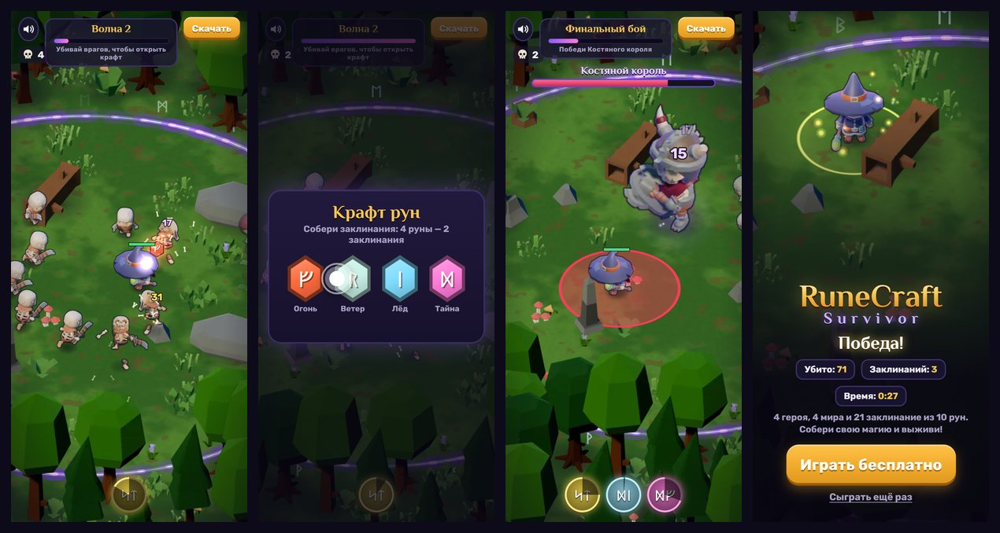

# RuneCraft Survivor — playable ad

Рекламный плейбл мобильной игры **RuneCraft Survivor** (roguelite-survivor с крафтом заклинаний из рун).
Это 30–40 секунд настоящего геймплея в одном HTML-файле на 1,6 МБ. Файл не делает ни одного внешнего запроса.



### ▶ [Играть в браузере](https://shark26-reg.github.io/runecraft-playable/) · [Скачать сборки](https://github.com/Shark26-reg/runecraft-playable/releases/latest)

Удобнее всего с телефона. На компьютере герой управляется мышью (зажать и тянуть) или клавишами WASD.
Добавьте к адресу [`?bot=1`](https://shark26-reg.github.io/runecraft-playable/?bot=1), и игра пройдёт сама; [`?lang=en`](https://shark26-reg.github.io/runecraft-playable/?lang=en) включает английский интерфейс.

## Сценарий

1. **Волна скелетов.** Маг стреляет сам, игрок только уводит его от толпы. С врагов падают руны.
2. **Крафт.** Руну перетаскивают на другую руну: *Молния + Стрела* дают **Цепную молнию**.
3. **Орда.** Скелеты прибывают кольцами, молния перескакивает по толпе.
4. **Второй крафт.** Из 4 рун можно собрать 2 заклинания из 5 рецептов. Одна пара не складывается, и игра об этом подсказывает.
5. **Костяной король.** Он встаёт из рунного круга. Перед ударом на земле загорается красный круг, из него надо уйти. Ниже половины здоровья король призывает свиту.
6. **Финальный экран.** Показывает статистику и кнопку «Играть бесплатно».

Если игрок не трогает экран, появляется палец-подсказка. В крафте палец показывает подходящую пару, а через 7 секунд крафт выполняется сам: рекламу часто смотрят, ничего не нажимая.

## Как сделано

| | |
|---|---|
| Движок | Свой, на чистом JavaScript и Canvas 2D, без библиотек. |
| Графика | Спрайты — рендеры 3D-моделей основной игры на Godot 4 с её светом, палитрой и тем же наклоном камеры. Поэтому земля, персонажи и деревья стыкуются, а плейбл выглядит как игра. 5 направлений, ещё 3 получаются зеркальным отражением. Атласы WebP. |
| Эффекты | Частицы, молнии, ударные волны, конусы огня, зоны и предупреждения рисуются процедурно, без картинок. |
| Интерфейс | HTML/CSS поверх холста: чёткий текст на любом экране, раскладка под портрет и альбом. |
| Языки | Русский и английский, выбор по языку устройства. |
| Звук | Web Audio. Включается после первого касания, есть кнопка выключения. Музыка — закольцованный отрывок с плавной склейкой. |
| Рекламные сети | Адаптер `src/js/ad.js` сам находит API сети: MRAID, ironSource DAPI, Google `ExitApi`, Meta `FbPlayableAd`, Mintegral, TikTok. Плейбл ждёт готовности и видимости, встаёт на паузу при скрытии, кнопка магазина вызывает API сети. |
| Производительность | Плотность пикселей ограничена 2x, невидимое не рисуется, силуэты для вспышек хранятся в половинном разрешении. В тесте стабильно 60 FPS. |

### Из чего складываются 1,6 МБ

| Что | Размер | Комментарий |
|---|---|---|
| Спрайты | 810 КБ | маг, два вида скелетов, босс, 21 декорация, бесшовная плитка земли |
| Звук | 267 КБ | 20 эффектов и 32 секунды музыки, MP3 моно |
| Шрифты | 45 КБ | три шрифта, урезанные до нужных символов |
| Код и стили | ~120 КБ | без минификатора, сборка убирает комментарии и отступы |

Внутри HTML всё хранится в base64, поэтому итог примерно на треть больше суммы.

## Сборки

`python tools/build.py` собирает в `dist/`:

| Файл | Для чего |
|---|---|
| `runecraft-playable.html` | Универсальный: сам определяет сеть. Подходит для AppLovin, Unity, ironSource, Mintegral, Meta, TikTok и для показа в браузере. |
| `runecraft-playable-mraid.html` | То же самое плюс `<script src="mraid.js">`: некоторые сети требуют это подключение явно. |
| `runecraft-playable-google.zip` | Для Google Ads: `index.html` с `ExitApi` и мета-тегом `ad.size`. |

Копия универсальной сборки кладётся в `docs/index.html` для GitHub Pages.

### Перед отправкой в рекламную сеть

1. Впишите ссылки на страницы игры в магазинах в `src/js/config.js` (`CONFIG.storeUrl`). Пока ссылок нет, кнопка в браузере показывает подсказку «Демо-версия», а в MRAID уходит пустая ссылка.
2. Пересоберите: `python tools/build.py`.
3. Прогоните файл через проверку выбранной сети: AppLovin Playable Preview, Unity Ad Testing, Google HTML5 Validator, Meta Playable Preview Tool.

## Разработка

```bash
cd src
python -m http.server 8000      # http://localhost:8000/
```

Отладочные параметры адреса:

| Параметр | Что делает |
|---|---|
| `?bot=1` | бот играет сам: держит дистанцию, обходит удары босса, крафтит |
| `?speed=2` | ускорение времени |
| `?stage=w2`, `?stage=boss`, `?stage=end` | начать со второй волны, с босса или с финального экрана |
| `?lang=en` | английский интерфейс |
| `?seed=N` | другая расстановка деревьев и травы |

```
src/
  index.html, style.css   разметка и стили интерфейса
  js/config.js            ссылки на магазины, масштаб, лимит длительности
  js/i18n.js              тексты RU/EN
  js/data.js              руны, рецепты, заклинания, враги (из game_data.gd основной игры)
  js/ad.js                адаптер рекламных сетей
  js/assets.js, audio.js  загрузка ресурсов, звук
  js/render.js, fx.js     проекция, спрайты, эффекты
  js/world.js             арена: земля, рунное кольцо, лес, препятствия
  js/entities.js          герой, скелеты, босс, снаряды, руны на земле
  js/spells.js            заклинания: цепь, конус, нова, зона
  js/ui.js, craft.js      интерфейс и окно крафта
  js/game.js, main.js     сценарий, ввод, главный цикл
  assets/                 готовые атласы, звуки, шрифты
tools/                    рендер спрайтов, подготовка ресурсов, сборка
```

### Пересборка ресурсов

Готовые ресурсы уже лежат в `src/assets`. Чтобы пересобрать их, нужен проект основной игры (Godot 4.7):

```bash
pip install -r tools/requirements.txt
# спрайты: рендер из моделей игры (обычный запуск Godot, не --headless)
<godot> --path <игра>/game --script <этот репозиторий>/tools/render/render_sprites.gd -- --out=<этот репозиторий>/build/raw
python tools/pack_sprites.py
python tools/prepare_audio.py <игра>/game/assets/audio
python tools/prepare_fonts.py <игра>/game/assets/fonts   # после правки текстов в i18n.js
python tools/build.py
```

## GitHub Pages

Демо публикуется из папки `/docs` ветки `main` (Settings → Pages → Deploy from a branch).
После `python tools/build.py` достаточно закоммитить обновлённый `docs/index.html`.

## Что проверено и чего нет

Проверено в Google Chrome без окна на трёх экранах: телефон в портрете 390×844, телефон боком 844×390 и монитор 1280×720.
- Полный проход ботом из файла, открытого с диска: ни одной ошибки в консоли, ни одного сетевого запроса.
- Ручное управление джойстиком и крафт перетаскиванием и нажатиями, включая неверную пару.
- Повторная игра после финального экрана.
- Английский интерфейс.
- Работа с имитацией MRAID: ожидание готовности, пауза при скрытии, вызов `mraid.open`.

Не проверено:
- в настоящих SDK рекламных сетей и их инструментах проверки;
- на реальных телефонах;
- на старых iOS (до 14): там нет WebP, и картинки не загрузятся.

Баланс подобран по прогонам бота: живой игрок может получать больше урона.

## Лицензии

Модели, звуки и музыка — CC0 (KayKit, Kenney, OpenGameArt), шрифты — SIL OFL 1.1. Подробности в [`licenses/`](licenses/CREDITS.md).

## In English

A playable ad for **RuneCraft Survivor**, a roguelite survivor with spell crafting from runes.
It fits about 40 seconds of real gameplay into a single 1.6 MB HTML file with no external requests:
- **Flow:** a skeleton wave, drag-and-drop rune crafting, a horde, a 4-rune craft and the Bone King boss.
- **Graphics:** sprites are rendered from the main game's 3D models in Godot 4.
- **Code:** plain JavaScript and Canvas 2D, with a DOM UI on top.
- **Languages:** RU and EN.
- **Ad networks:** MRAID, ironSource DAPI, Google ExitApi, Meta and Mintegral hooks are built in.

[Play in the browser](https://shark26-reg.github.io/runecraft-playable/?lang=en) · [Downloads](https://github.com/Shark26-reg/runecraft-playable/releases/latest)
